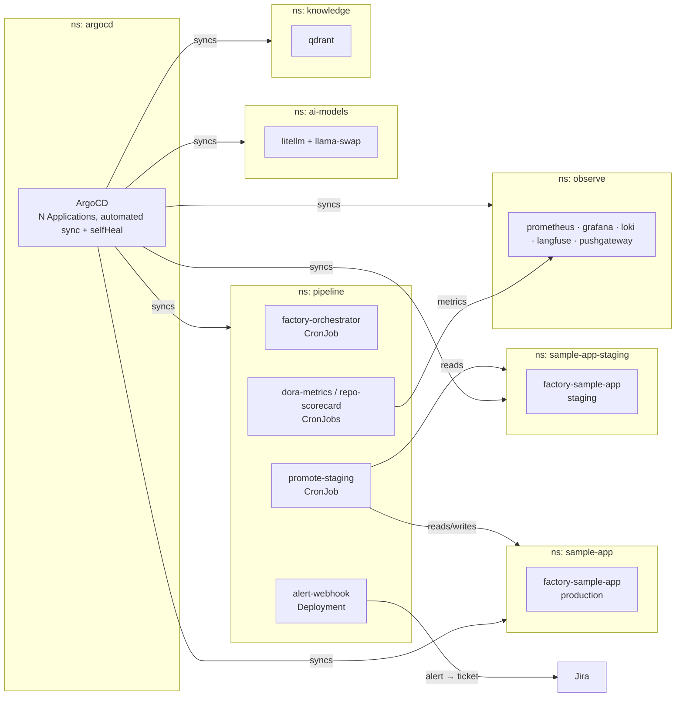
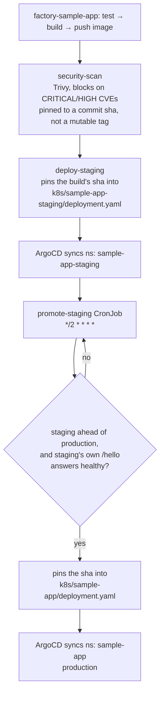

# factory-manifests

GitOps source of truth for the **k3s-factory** cluster. Every workload below is declared here and synced by ArgoCD with automated sync and self-heal — nothing is `kubectl apply`'d by hand except a new Application's first registration.

It backs [`ai-software-factory`](https://github.com/egaraev/ai-software-factory) (the agent pipeline) and [`factory-sample-app`](https://github.com/egaraev/factory-sample-app) (the app the pipeline builds and ships), and includes a staged-delivery pipeline that gates production behind an automated staging health check — no build reaches production without first proving itself in staging.

## Namespace topology



## Staged delivery

A build reaches production only after passing a security scan, running in staging, and answering its own health check — there is no path from a merged PR to production that skips staging.



`promote-staging` does its own health check directly against staging's Service — there is no separate smoke-test Job to correlate a result from. It is the only thing that is ever allowed to change production's image line.

## Repository layout

```
k8s/
├── bootstrap/            ArgoCD Application definitions (one kubectl apply each, once)
├── platform/             namespaces, GPU RuntimeClass, device plugin
├── llm/                  litellm, llama-swap — the model gateway
├── knowledge/             qdrant — the knowledge base backing every agent
├── observe/              prometheus, grafana, loki, langfuse, pushgateway
├── orchestrator/         pipeline CronJobs: orchestrator, promote-staging, dora-metrics, repo-scorecard
├── sre-agent/             alert-webhook Deployment + its RBAC
├── sample-app/            production factory-sample-app — Deployment + Service
├── sample-app-staging/    staging factory-sample-app — Deployment + Service
└── secrets/               how to create the real secrets (never committed)
```

## Bootstrapping

1. Point `kubectl` at the cluster.
2. Install ArgoCD:
   ```sh
   kubectl create namespace argocd
   kubectl apply -n argocd -f https://raw.githubusercontent.com/argoproj/argo-cd/stable/manifests/install.yaml
   ```
3. Create the repo-access secret and the app secrets — see `k8s/secrets/README.md`.
4. Register each Application once — there is no App-of-Apps watching `k8s/bootstrap/`, so every file there needs its own apply:
   ```sh
   kubectl apply -f k8s/bootstrap/platform-app.yaml
   kubectl apply -f k8s/bootstrap/llm-app.yaml
   kubectl apply -f k8s/bootstrap/knowledge-app.yaml
   kubectl apply -f k8s/bootstrap/observe-app.yaml
   kubectl apply -f k8s/bootstrap/orchestrator-app.yaml
   kubectl apply -f k8s/bootstrap/sre-agent-app.yaml
   kubectl apply -f k8s/bootstrap/sample-app-app.yaml
   kubectl apply -f k8s/bootstrap/sample-app-staging-app.yaml
   ```

From here, ArgoCD owns every change — editing a manifest and pushing to `main` is the only deploy step; sync and self-heal do the rest.
